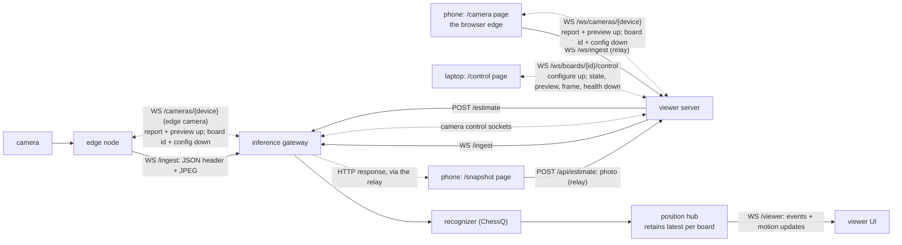

# Architecture

Four packages in one `uv` workspace. **Packages are deployment boundaries**, not
folders-for-tidiness: each `packages/*` member is independently deployable, and the
import rules below are enforced by a test, not by convention.

## The four packages

| Package (`import`) | Role | May import |
|---|---|---|
| `board-reader-core` (`board_reader_core`) | the shared contract: L3 protocol, L1→L2 wire, camera control contract (pydantic models, with their JSON Schema in `schema`), recording format, sim helpers | numpy, opencv, pydantic |
| `board-reader-edge` (`board_reader_edge`) | the **edge** node ("Pi", L1): capture, crop (static or from `/control`), forward | core only (plus yt-dlp for `camera`) |
| `board-reader-inference` (`board_reader_inference`) | the **inference** node (L2): stateless recognizer + gateway | core only |
| `packages/viewer` (Node) | the viewer: a SvelteKit app whose pages are prerendered, with `/api/*` and `/api/client-log` as routes, served by `server/main.ts`, which adds the `/ws/*` relay and the TLS port — `src/routes/api`, `server/{main,ws,tls}.ts`; pages `/`, `/camera`, `/control`, `/snapshot` | nothing |

> [!danger] The separation rule
> `edge` and `inference` **never import each other**. They communicate solely over the
> wire: `board_reader_core.wire` frames in, `board_reader_core.protocol` events out.
> `core` imports neither. Guarded by `tests/test_layer_separation.py` (an AST import scan
> plus a manifest check) *and* by packaging — neither node depends on the other. The CLI
> and compose file are the only glue, and only across the network.
>
> The point is that the sim and the real deployment are the same system. If the browser
> edge could reach into the recognizer, the Pi could not.

`DESIGN.md` calls the inference node "central / Jetson" and the edge node "Pi". Same
concepts, friendlier names in code.

## Two ingress paths

The gateway accepts frames two ways, for two different jobs.



**Streaming path (`WS /ingest`)** — the design's main line, live since M2. The edge
sends the board as two WebSocket messages, a JSON header then the binary JPEG. Every
frame carries `board_id`, `capture_ts` (sensor time, not receive time), `seq`,
`stability`, an edge-measured `sharpness`, and (inside a burst) a `burst_id`. The
gateway reads the frames its read scheduler picks the same way `POST /estimate` reads a
photo: the whole JPEG through the recognizer
(`recognizer.frame_reader`), which finds the board and its orientation itself
([[recognition-pipeline]]) and reports the board's direction in the image beside the
read (DESIGN D10). A per-board **orientation guard** drops a streamed read whose
direction is more than 45° off the board's recent reads, before the debounce sees
it. Old recordings carry a legacy **`corners`** field (the
playing-surface quad the edge used to send): `wire.Frame` still parses it so they replay,
the recording keeps it, and recognition ignores it. No edge sends it any more.

**The browser edge (`GET /camera` on the viewer)** — DESIGN §6's "virtual Pi", and since
Phase C a **dumb camera** (DESIGN D11): a full-screen viewfinder with one
status line and **no controls at all**. Everything about what it films is set from the
**control UI** on the laptop (`GET /control` on the viewer), held per board on the
inference node, and pushed to the phone, which applies it:

- **The node names the cameras** (DESIGN D18). The phone keeps a random device id (a
  UUID) in `localStorage` and holds `WS /cameras/{device_id}` open from the moment the
  page loads. A camera's board id is that device id, for good. The node answers with
  the board id and the camera's name (`assigned`): a new camera is called the lowest
  `board-N` no other camera's name uses, until `/control` renames it. `/control` lists
  every known camera over `WS /cameras` (name, short device id, link, stream, last
  frame, lens and frame), renames one inline (an alias the live page shows, from the
  `names` message on `/viewer`), forgets a disconnected one, and shows a QR code that
  opens `/camera` on a phone. The phone names its device id on every frame, and
  `/ingest` refuses a frame under a board id that is another camera's.
- **The control channel is pushed over WebSockets; nothing polls.** The
  phone's socket is open from the moment the page loads. It sends
  its `CameraReport` — the lenses `enumerateDevices` lists, the label of the one open,
  the frame size it delivers and the state of its stream — on connect and whenever it
  changes. The node pushes that board's `CameraConfig` on connect and on every change:
  the **crop rectangle** (fractions of the full frame, or none for the whole frame), the
  **lens** (by label), the **capture resolution** (720p, 1080p or 2160p, asked for as an
  `ideal` constraint) and **streaming** on/off. Each `/control` page holds
  `WS /boards/{id}/control`: the node pushes the state (config, last report, whether
  the phone is connected) on connect and on every change, plus a health tick once a
  second (recognizer, ingest counters, last-frame age, frames per second, all on the
  node's clock, and the board's direction from the live reads: the side White sits on,
  and `camera_moved`); the page sends `configure` with the whole config. Both clients
  reconnect with backoff; a phone that loses the link keeps its last config and keeps
  streaming on `/ws/ingest`. The contract — every message type and its direction — is
  `board_reader_core.control` (each socket direction one union discriminated on
  `type`, in the JSON Schema of `board_reader_core.schema`); the node keeps the state
  (`control.camera.registry.CameraRegistry`, the single source of truth) and persists each
  board's config to `BR_CAMERA_CONFIG` (`serve` sets `data/camera-config.json`; empty
  keeps it in memory only), so a restart keeps the framing. Each socket's outbox keeps only the
  latest message of each type, so a slow page cannot make the node buffer. The frames
  stay on `/ws/ingest`, whose framing and recording are unchanged
  ([DESIGN D11](DESIGN.md) says why the control messages did not join them).
- **The phone still crops, so the wire is unchanged.** It measures motion and sharpness
  on the configured crop, throttles with a JS mirror of the edge's `MotionMeter` +
  `AdaptiveForwarder` (~1 fps at rest, ~12 fps through motion and for a 1 s tail after
  it), and streams the crop
  (long side ≤ 960 px) on `/ws/ingest`. The meter's 32×32 thumbnail is an area average
  (the crop drawn at 256×256, then 8×8 block means), like the edge's `cv2.INTER_AREA`:
  drawn straight at 32×32 it kept the sensor noise and missed every hand
  ([live latency](reports/2026-11-24-live-latency.md)). The crop matters — ChessQ needs the board to
  fill at least half of the image width
  ([[recognition-pipeline#Framing: the board must fill the frame]]) — which is why the
  control UI warns about a missing, too-wide or upright rectangle, and an upright phone.
- **A full-frame preview** (480 px long side, every 1.5 s) goes up the phone's socket
  as a binary message, **only while a `/control` page is connected** to that board or
  Auto-frame watches the camera for a move (DESIGN D21): the node says `previews` on
  and off as that changes. Auto-frame locates at most one preview every 3 s, on the read
  worker and only when no read waits.
- **A full frame** goes up once when the node asks (`send_full_frame`: the camera
  registered, started streaming, or moved): a `full_frame` header, then the uncropped
  JPEG (long side ≤ 1920 px). The node finds the board in it and pushes the crop
  (DESIGN D21). The node forwards it to every page, which draws the rectangle on the camera's
  whole field of view, beside the cropped frame the node actually received (pushed on
  the health tick whenever a new one arrived). Images reach the page as base64 inside
  the JSON message, shown as a `data:` URL.
- **Lenses are chosen by label.** iOS ≥16.3 exposes every rear lens through
  `enumerateDevices` (only once permission has populated the labels), but nothing
  identifies which is the ultra wide: deviceIds are per-session, labels are localised,
  order is not guaranteed, and iOS Safari implements no `zoom` capability to fake it
  with. So the phone reports them all and the config names one **by label**, the only
  property that survives a reload.

What went in Phase C: the board-plane tracker, the labelled corners and rotate labels,
automatic and periodic re-detection (`/detect`), and the portrait block. A portrait phone
now streams anyway; it says so in its status line, and the control UI warns.

Because
`getUserMedia` demands a secure context and phones balk at a second self-signed origin,
the page talks *only* to the viewer's own origin: the viewer relays the node's sockets
under `/ws/` (`/ws/ingest`, `/ws/viewer`, `/ws/cameras/{device}`, `/ws/cameras`,
`/ws/boards/{id}/control`) and its HTTP API under `/api/` to the inference node (pure network
glue — it imports nothing of the Python packages), and `--tls-port` serves the whole
thing over a cached self-signed certificate.

On the **Python edge** (`board-reader-edge feed`), frames are cropped to an optional
static `--roi x,y,w,h` (fractions of the frame, the same `CropRect` the control channel
uses), then pass a `MotionMeter` (32×32 grayscale differencing → stability) and the
`AdaptiveForwarder` (DESIGN D4: ~1 fps keepalive at rest, ~12 fps burst through motion,
with hysteresis, and the burst rate kept for `tail_s` = 1 s after a burst so the node's
burst-end reads find fresh frames). There is no detection and no rectification on any edge.

**`board-reader-edge camera <source>`** (DESIGN D19) is the Python edge as a camera on
the control channel, the phone's twin. `camera/link.py` keeps the device id in a state
file and holds `WS /cameras/{device_id}` on the node (report, previews, `assigned`,
`config`, `replaced`). `camera/stream.py` resolves the source (yt-dlp for a web page,
one format of at most 1080 lines; OpenCV directly for a file or `rtsp://`), reads it with
OpenCV's FFmpeg backend and samples it at the phone's 20 fps; a video plays at real time
from `--start`, a live stream reconnects. `camera/run.py` runs the capture, crop, meter,
forwarder and encode on a camera thread, and the two sockets and the previews on the
event loop; the frames go out on `/ingest` (latest wins, `client.IngestLink`) under the
board id the node named (the device id), with the device id in the header.

On the **gateway**, the `/ingest` handler acks each frame on receipt and hands it to
`FrameIngest.submit`, where the board's read scheduler decides on that frame at once. A
scheduled frame joins **one read queue** for all boards, with its board's held frames
and rules taken at arrival; one worker serves the queue oldest first, one recognizer
call at a time, off the event loop (DESIGN D17). A slow model or many boards therefore
delay a board's events but never change which frames it reads or what they settle to,
and they can't stall viewers, HTTP, or the socket. Only a sustained overload drops
reads, keepalive reads first, each one counted on `/healthz` and recorded. An ack means
*received*, not *estimated*. Every frame also becomes a **motion update** on
`/viewer` (`{"type": "motion", board_id, moving, stability, ts}`, at most 5/s per board,
always on a change of `moving`), so the live view can show a hand on the board between
the sparse reads. It is display state: never retained, recorded or replayed.

**Recording (DESIGN WP-H2).** The same handler appends every arriving frame to a recording
session — `manifest.json` + an append-only `frames.ndjson` + the JPEGs exactly as
received (`board_reader_core.recording`). It sits at `/ingest` deliberately: that is
the one socket *every* edge crosses, so the CLI feed, a Pi and the phone `/camera`
page are all recorded without any of them knowing, and a future edge is recorded the
day it is written. It also sits **before** the scheduler and the read queue — a
recording is the *input* to a run, not a log of what the recognizer got round to.

`board-reader-edge feed --recording <dir>` puts a session back on the wire, re-sending
the stored bytes verbatim (no JPEG round trip, which would perturb the very pixels a
reproduction is about). Recording is on for any `serve`d run and off for
`create_app()` in tests — see [[runbook#Reproducing a run]].

**Snapshot path (`POST /estimate`)** — one photo in, one position event out. The body is
the photo as shot; nothing else is needed, because the recognizer finds the board in it.
See [[recognition-pipeline]].

> [!note] Why `/estimate` publishes to the hub
> A snapshot read is a real position event, so it goes to the hub like any other and any
> connected viewer sees it.

## Surfaces

**Inference node** (`:8000`)

| Surface | Purpose |
|---|---|
| `WS /ingest` | edge → gateway frame stream |
| `WS /viewer` | position-event stream out (retained latest per board first, then live), interleaved with motion updates (DESIGN §5) |
| `POST /estimate` | one photo → one position event (+ `upload`, `warnings`) |
| `POST /labels/{upload}` · `GET /uploads` · `GET /uploads/{id}/photo` | ground-truth labels for retained photos (`BR_SAVE_UPLOADS`), in the chess frame |
| `GET /boards/{id}` | latest retained event for a board |
| `GET /boards/{id}/frame` | latest raw JPEG ingested for a board (video-like preview) |
| `WS /cameras/{device_id}` | the phone's camera control socket: report and previews up; its board id and name, config, `previews` on/off and `replaced` down |
| `WS /cameras` | the control UI's list of every known camera, pushed on change and once a second; `rename` (sets a name) and `forget` up |
| `WS /boards/{id}/control` | a control page's socket: `configure` up; state, preview, received frame and a 1 Hz health tick down |
| `GET /healthz` | liveness (+ `ingest` counters, `misoriented` among them: reads the orientation guard dropped; `recognizer`: name, model, `fallback` when the stub serves; `recording`: session path, frames, bytes) — see the warning in [[runbook#Verifying a restart]] |

**Viewer node** (`:8080`)

| Surface | Purpose |
|---|---|
| `GET /` | live-position UI (chessground), one card per board |
| `GET /snapshot` | the phone page: capture → read → output (a photo → a position, correctable and labelable) |
| `GET /camera` | the phone page: a dumb camera that streams what the control UI configured (the browser edge) |
| `GET /control` | the laptop page: the list of cameras (name one inline, forget a disconnected one) and a QR code for `/camera`; for the picked camera, the crop rectangle on its full-frame preview, lens, resolution, the board's settle `rules`, start/stop, health |
| `WS /ws/<path>` | same-origin relays to the inference node's sockets (`ingest`, `viewer`, `cameras/{device}`, `cameras`, `boards/{id}/control`) |
| `/api/<path>` | same-origin relay of the inference node's whole HTTP API |

The snapshot page's correction panel is where a wrong square gets fixed — the privileged
Empty row, then a colour-symmetric piece grid with the square's actual probabilities, so the
operator can see *what the recognizer was torn between* rather than just that it was wrong:

![[correction-panel-mobile.png|300]]

The viewer serves the prerendered pages through adapter-node's handler and relays the
node same-origin: the HTTP API through the catch-all route `/api/[...path]`, every
socket through `server/ws.ts` (`/ws/<path>` → `/<path>`, so `/ws/ingest`, `/ws/viewer`,
`/ws/cameras/{device}`, `/ws/cameras` and `/ws/boards/{id}/control` need no viewer change).
`--tls-port` serves the same app over a cached self-signed certificate. The SvelteKit 3
app builds to `packages/viewer/build/` (`make ui`). `BR_INFERENCE_WS` /
`BR_INFERENCE_HTTP` address the *viewer's* hop to the node and never reach the browser.

One origin is what lets a single certificate cover everything a phone needs, and
it is also why the stack tunnels with one port forwarded (`.claude/skills/tunnel`).
Until 2026-08-07 only the camera page worked this way; the live and snapshot pages were
handed an absolute `http://<lan-ip>:8000` and talked to the node directly, which is why
the node still runs CORS middleware — nothing in this repo now depends on it.

## The frontend: one typed library, four routes

The four pages are a SvelteKit 3 / Svelte 5 (runes) / TypeScript-strict app
(`packages/viewer`), prerendered and built to `packages/viewer/build/` (`make ui`,
or `pnpm build`) — generated and gitignored, not a source. `server/main.ts` refuses to
start if that directory is missing (see `docs/TESTING.md`).

Before the rewrite, three hand-written HTML pages each carried their own
near-identical copy of the same logic — FEN parsing, the board-plane tracker, the
L1→L2 wire framing — and the differences between the copies were the bugs.
`src/lib/**` is now the single, Vitest-tested version of each:

| Module | Owns |
|---|---|
| `lib/protocol/` | the wire contract. `generated.ts` holds a zod validator and a readonly type per message (L3 position events and motion on `/ws/viewer`, L1→L2 headers on `/ws/ingest`, the camera control messages), generated from the pydantic models by `make protocol` (`tools/gen_protocol.py`) and checked for drift by `tests/test_protocol_ts.py`; `checks.ts` holds the TS twins of the schema's `x-check` rules; `index.ts` holds `parseWire` (the one place untrusted wire data becomes a typed value), the class vocabulary and board frame, and the node's HTTP replies and `/ingest` acks, which core does not model |
| `lib/api.ts` | same-origin, always-relative URL construction (`/api/…`, `/ws/…`) — nothing here ever names an origin, which is what keeps the pages working unchanged on a LAN, over https, and behind a tunnel |
| `lib/board/fen.ts` | FEN field 1 ⇄ 8×8 grid, clamped and re-emitted so a malformed placement can't shift the grid the diff and chessground both index into |
| `lib/edge/{motion,ingest,sharpness,cameralink,device}.ts` | the `/camera` page's browser edge: a JS mirror of `board_reader_edge`'s `MotionMeter`/`AdaptiveForwarder`, the two-message (JSON header + JPEG) `/ws/ingest` sender, the focus score, the phone's camera control socket, and its device id |
| `lib/control/{messages,link,cameras}.ts` · `lib/socket.ts` | the camera control channel's upward messages (built on the generated types), the control page's socket, the camera list's socket, and the reconnecting socket the clients share |
| `lib/stores/{positions.svelte,liveness}.ts` | the live position stream as Svelte 5 state — deliberately not a state machine over positions (DESIGN D1): the only history kept is the previous grid, and only to diff a changed square |

`src/routes/` holds the four pages (`+page.svelte` for `/`, `camera/+page.svelte`,
`control/+page.svelte`,
`snapshot/+page.svelte`) and the page-specific components each composes from
`lib/components/{live,camera,control,snapshot}/` — UI, not shared logic. 273 Vitest cases
cover `src/lib/**` today, and 21 Playwright tests drive the four built pages in a
real Chromium; see [[TESTING#1. Automated tests]].

The vendored chessground 9 (`static/vendor/chessground*`) is gone with the rest of
`static/`: the app now depends on the published `@lichess-org/chessground` 10
instead — the unscoped `chessground` package on npm is deprecated, lichess moved it
to the scoped name.

## Where board detection lives

Nowhere in the live pipe: the recognizer finds the board itself (D10). The geometric
detector (`detect_board_quad`, `quad_aspect`) survives only as an offline QC tool in
`tools/video/boarddetect.py`, where `check_angle.py` measures a broadcast's camera
elevation with it. Core and both nodes no longer import it.

## The position event

The canonical output is a **full 8×8 grid of 13-vectors** — a probability distribution per
square over `empty` plus the twelve piece classes. Everything else is derived: the
`placement` string is the per-square argmax, the position `confidence` is a reduction over
per-square maxima.

The full distribution is emitted rather than a scalar per square because a scalar collapses
*what a square was confused with*. `0.4 knight / 0.35 bishop` and `0.4 empty / 0.4 pawn`
both read as "0.4", and that difference is exactly what downstream probabilistic move
inference needs. At fp16 the grid is ~1.6 KB — negligible next to the JPEG.

Full field-by-field spec: [[DESIGN#5. Position stream protocol (L3 output)]].

**One contract, two languages (DESIGN D13).** Every JSON message between the node and
the browser — position events and motion updates on `/viewer`, the frame header on
`/ingest`, the camera control messages — is a strict pydantic dataclass in
`board_reader_core` (`protocol`, `control`, `wire`; the shared rules in `wiremodel`).
The models validate on construction, on assignment and on parsing: strict scalars,
finite numbers, ranges as constraints, unknown keys refused, and a one-line
`ValueError` naming the field. `python -m board_reader_core.schema` prints their JSON
Schema, one document with a `$defs` entry per message and per socket union, and the
viewer's TypeScript types and validators are generated from it. Two rules are beyond
JSON Schema and are named by `x-check` for the TypeScript side to implement:
`isPlacement` (eight ranks of eight squares) and `cropInside` (`x + w <= 1`,
`y + h <= 1`).

## Who reads the stream

The L3 egress has two consumers today, and both are deliberately memoryless.

| Consumer | What it is |
|---|---|
| the **viewer** (`GET /`) | draws the latest event per board — a screen, not a record: the event's `placement` (the settled board), its `pending` squares as dashed amber rings, and a motion chip driven by the motion updates; no confidence or stability bars |
| `board-reader-inference positions` | a headless tail of `WS /viewer`: each event on stdout in readable form, and with `--out` each event as one line of the exact §5 JSON the socket carried; it skips motion updates |

Until the tail landed, the only consumer of that socket was a browser page, so a run's
output could be watched but never captured, diffed, or asserted — the result lived on a
screen. A capture *is* the stream rather than a rendering of it, which makes two runs
comparable and makes "a stream of positions came out" a claim a test can check.

```bash
board-reader-inference positions                       # tail every board
board-reader-inference positions --changes-only        # ... only when a board moves
board-reader-inference positions --out run.ndjson --quiet
```

`--changes-only` suppresses an event whose placement matches that board's previous one:
an at-rest board republishes the same position at the node's keepalive read (every 2 s,
DESIGN §4.3), and a log of that is noise. A board's first event is always reported — "never seen before" and
"held still" are different facts and the tail keeps them apart. Walkthrough in
[[TESTING#Option L — Watch or capture the position stream]]; operator recipes in
[[runbook#Capturing a run's positions]].

## Temporal consistency — the layer nobody has built

> [!warning] `stability` is computed on the edge, rides every event, and no consumer segments moves on it
> Inside the system the forwarder and the read scheduler use it; downstream, only the live
> view's motion chip shows it (through the motion updates).
> That is not a bug in the CV layer and not a violation of DESIGN. The layer that would
> use it does not exist — in this repo or outside it.

The estimator is stateless per frame **by decision** (DESIGN D1): pixels in, what it sees
out, with no memory, no move tracking, no legality. Everything that turns a *sequence* of
noisy per-frame reads into a stable position history — smoothing across frames, segmenting
moves on the advisory `stability` hint, rejecting a one-frame flicker as a hand crossing
the board rather than a capture — belongs to the **consumer**, and DESIGN says so twice
(D3, and the closing line of §5). That part is the design working as intended.

What is missing is the consumer itself. Nothing anywhere demonstrates a noisy per-frame
stream becoming a stable position history. The gap is not a missing feature; it is a
missing layer.

The headless tail does not close it, deliberately. It diffs consecutive placements so a
human can read the stream, and that is all: a `SquareTransition` is a difference between
two strings, and a hand crossing the board, a misread and a real capture all produce them
identically. It smooths nothing — a piece flickering between two classes on alternate
frames yields a transition on *every single frame*. That is the honest picture of what a
stateless estimator emits, and precisely the argument for the layer above it.

One narrow exception ships since 08-13: on *streamed* events the gateway publishes a
settled board as `placement` (DESIGN §5, D15) — a per-square display debounce (an unbroken 0.5 s of
consistent reads, at least two, `board_reader_inference.stream.settle.stabilizer`, never composing a board *less*
possible than the one it already holds unless the board's `rules` are `free`, and never
stale by more than ~3 settle windows) over the raw placements, born from the first
phone trial where a hand mid-move and a coin-flip two-kings read made the live board
flicker at burst rate. It is a debounce, not the missing layer: no move model, no
legality, no use of `stability`, and it holds whatever the reads converge to — the trial's
persistent d8/e8 misread settles *wrong*, just stably. Each read stays untouched
as the event's `square_dist`, with `pending` naming where it disagrees.

The seam is `WS /viewer`, or an `.ndjson` capture of it — the same bytes either way.
Anything cleverer than a debounce lives on the far side of that seam and wants its own
design. DESIGN §9 still carries "does `stability` earn its keep?" as an open question; it
cannot be answered until something consumes it.

## Related

- [[recognition-pipeline]] — what happens between "frame arrives" and "event published"
- [[runbook]] — how to actually run these processes
- [[glossary]]
