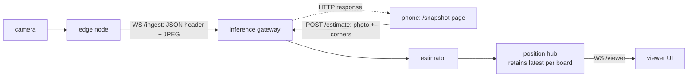

# Architecture

Four packages in one `uv` workspace. **Packages are deployment boundaries**, not
folders-for-tidiness: each `packages/*` member is independently deployable, and the
import rules below are enforced by a test, not by convention.

## The four packages

| Package (`import`) | Role | May import |
|---|---|---|
| `board-reader-core` (`board_reader_core`) | the shared contract: L3 protocol, L1→L2 wire, sim helpers, geometry-only board detection | numpy, opencv |
| `board-reader-edge` (`board_reader_edge`) | the **edge** node ("Pi", L1): capture, detect, rectify, forward | core only |
| `board-reader-inference` (`board_reader_inference`) | the **inference** node (L2): stateless estimator + gateway | core only |
| `board-reader-viewer` (`board_reader_viewer`) | serves the live-position UI and the phone snapshot page | nothing |

> [!danger] The separation rule
> `edge` and `inference` **never import each other**. They communicate solely over the
> wire: `board_reader_core.wire` frames in, `board_reader_core.protocol` events out.
> `core` imports neither. Guarded by `tests/test_layer_separation.py` (an AST import scan
> plus a manifest check) *and* by packaging — neither node depends on the other. The CLI
> and compose file are the only glue, and only across the network.
>
> The point is that the sim and the real deployment are the same system. If the browser
> edge could reach into the estimator, the Pi could not.

`DESIGN.md` calls the inference node "central / Jetson" and the edge node "Pi". Same
concepts, friendlier names in code.

## Two ingress paths

The gateway accepts frames two ways, for two different jobs.

**Streaming path (`WS /ingest`)** — the design's main line, live since M2. The edge
sends an already-rectified board crop as two WebSocket messages, a JSON header then the
binary JPEG. Every frame carries `board_id`, `capture_ts` (sensor time, not receive
time), `seq`, `stability`, and (inside a burst) a `burst_id`.

On the **edge**, frames pass three stages, in cost order: a `MotionMeter` (32×32
grayscale differencing → stability), the `AdaptiveForwarder` (DESIGN D4: ~1 fps
keepalive at rest, ~12 fps burst through motion, with hysteresis), and only then the
`Rectifier` — detection costs ~90–100 ms, so dropped frames never pay for it, and in
auto mode it re-detects on a ~1 s capture-time cadence, cropping intervening frames
against the cached homography.

On the **gateway**, the `/ingest` handler acks each frame on receipt and hands it to a
per-board **latest-wins inbox** (one un-estimated frame; a newer one displaces it) whose
worker runs the estimator off the event loop. A burst is therefore estimated at whatever
rate the model sustains — skipping the stale end of the burst, never the freshest frame —
and a slow model can't stall viewers, HTTP, or the socket. An ack means *received*, not
*estimated*.

**Snapshot path (`POST /estimate`)** — a convenience ingress that turned into the way the
system is actually used today. The body is the **original photo**, not a rectified crop,
plus the four surface corners as a query parameter. Cropping full-piece boxes from the
original photo beats cropping tiles from a warped rectification, because the warp smears
tall pieces and the tile truncates them. See [[recognition-pipeline]].

> [!note] Why `/estimate` publishes to the hub
> A snapshot read is a real position event, so it goes to the hub like any other and any
> connected viewer sees it. The one exception is the uncalibrated occupancy-only answer —
> that is returned in the HTTP response but never published, because the hub is supposed
> to carry positions, not "something is on this square".

## Surfaces

**Inference node** (`:8000`)

| Surface | Purpose |
|---|---|
| `WS /ingest` | edge → gateway frame stream |
| `WS /viewer` | position-event stream out (retained latest per board first, then live) |
| `POST /estimate` | one photo → one position event (`corners`, `autorotate`, `debug`) |
| `POST /calibrate` | one labeled photo → per-set exemplar bank ([[calibration-and-the-bank]]) |
| `POST /detect` | photo → proposed corner quad, geometry only |
| `GET /boards/{id}` | latest retained event for a board |
| `GET /boards/{id}/frame` | latest raw JPEG ingested for a board (video-like preview) |
| `GET /healthz` | liveness — see the warning in [[runbook#Verifying a restart]] |

**Viewer node** (`:8080`)

| Surface | Purpose |
|---|---|
| `GET /` | live-position UI (chessground), one card per board |
| `GET /snapshot` | the phone page: photo → position, zero taps |

The snapshot page's correction panel is where a wrong square gets fixed — the privileged
Empty row, then a colour-symmetric piece grid with the square's actual probabilities, so the
operator can see *what the estimator was torn between* rather than just that it was wrong:

![[correction-panel-mobile.png|300]]

The viewer is a static-file server with two injected values (`BR_INFERENCE_WS`,
`BR_INFERENCE_HTTP`); the browser talks to the inference node directly for data. That is
why the inference node runs CORS middleware.

## Where board detection lives

Detection is conceptually an **edge** responsibility (DESIGN D4: the camera/board geometry
is local and detection is cheap). But the algorithm lives in `board_reader_core.boarddetect`,
because the browser edge cannot run OpenCV cheaply and needs to delegate detection to the
inference node's `/detect`, while a real Pi edge imports the same module locally.

Core still imports neither node, so the separation rule holds. What moved is the *code
location*, not the responsibility.

> [!important] Detection returns geometry, never orientation
> `detect_board_quad` returns four corners in geometric order. Which physical corner is
> `a8` is not knowable from the geometry, and the CV layer is forbidden from inferring it
> from the pieces (DESIGN decision #15). Orientation is resolved separately — see
> [[recognition-pipeline#Orientation]].

## The position event

The canonical output is a **full 8×8 grid of 13-vectors** — a probability distribution per
square over `empty` plus the twelve piece classes. Everything else is derived: the
`placement` string is the per-square argmax, the position `confidence` is a reduction over
per-square maxima.

The full distribution is emitted rather than a scalar per square because a scalar collapses
*what a square was confused with*. `0.4 knight / 0.35 bishop` and `0.4 empty / 0.4 pawn`
both read as "0.4", and that difference is exactly what downstream probabilistic move
inference needs. At fp16 the grid is ~1.6 KB — negligible next to the JPEG.

Full field-by-field spec: [[DESIGN#5. Position stream protocol (L3 output)]].

## Related

- [[recognition-pipeline]] — what happens between "frame arrives" and "event published"
- [[runbook]] — how to actually run these processes
- [[glossary]]
