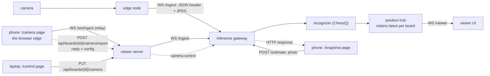

# Architecture

Four packages in one `uv` workspace. **Packages are deployment boundaries**, not
folders-for-tidiness: each `packages/*` member is independently deployable, and the
import rules below are enforced by a test, not by convention.

## The four packages

| Package (`import`) | Role | May import |
|---|---|---|
| `board-reader-core` (`board_reader_core`) | the shared contract: L3 protocol, L1→L2 wire, sim helpers, geometry-only board detection | numpy, opencv |
| `board-reader-edge` (`board_reader_edge`) | the **edge** node ("Pi", L1): capture, static crop, forward | core only |
| `board-reader-inference` (`board_reader_inference`) | the **inference** node (L2): stateless recognizer + gateway | core only |
| `board-reader-viewer` (`board_reader_viewer`) | serves the live-position UI and the phone pages (snapshot + camera), and relays the camera page's traffic to the inference node | nothing |

> [!danger] The separation rule
> `edge` and `inference` **never import each other**. They communicate solely over the
> wire: `board_reader_core.wire` frames in, `board_reader_core.protocol` events out.
> `core` imports neither. Guarded by `tests/test_layer_separation.py` (an AST import scan
> plus a manifest check) *and* by packaging — neither node depends on the other. The CLI
> and compose file are the only glue, and only across the network.
>
> The point is that the sim and the real deployment are the same system. If the browser
> edge could reach into the recognizer, the Pi could not.

`DESIGN.md` calls the inference node "central / Jetson" and the edge node "Pi". Same
concepts, friendlier names in code.

## Two ingress paths

The gateway accepts frames two ways, for two different jobs.



**Streaming path (`WS /ingest`)** — the design's main line, live since M2. The edge
sends the board as two WebSocket messages, a JSON header then the binary JPEG. Every
frame carries `board_id`, `capture_ts` (sensor time, not receive time), `seq`,
`stability`, and (inside a burst) a `burst_id`. The gateway reads every frame the same
way `POST /estimate` reads a photo: the whole JPEG through the recognizer
(`recognizer.frame_reader`), which finds the board and its orientation itself
([[recognition-pipeline]]). Old recordings carry a legacy **`corners`** field (the
playing-surface quad the edge used to send): `wire.Frame` still parses it so they replay,
the recording keeps it, and recognition ignores it. No edge sends it any more.

**The browser edge (`GET /camera` on the viewer)** — DESIGN §6's "virtual Pi", and since
Phase C a **dumb camera** (DESIGN D10, "dumb camera"): a full-screen viewfinder with one
status line and **no controls at all**. Everything about what it films is set from the
**control UI** on the laptop (`GET /control` on the viewer), held per board on the
inference node, and pushed to the phone, which applies it:

- **The control channel is a poll.** Every 500 ms the phone posts its
  `CameraReport` — the lenses `enumerateDevices` lists, the label of the one open, the
  frame size it delivers and the state of its stream — to
  `POST /boards/{id}/camera/report`, and the reply is that board's `CameraConfig`: the
  **crop rectangle** (fractions of the full frame, or none for the whole frame), the
  **lens** (by label), the **capture resolution** (720p, 1080p or 2160p, asked for as an
  `ideal` constraint) and **streaming** on/off. A config change reaches the phone within
  one poll; nothing has to stay connected while the camera is idle. The contract is
  `board_reader_core.control`; the node keeps it in memory (`camera_control.py`), so a
  restart forgets the config and the control UI sets it again.
- **The phone still crops, so the wire is unchanged.** It measures motion and sharpness
  on the configured crop, throttles with a JS mirror of the edge's `MotionMeter` +
  `AdaptiveForwarder` (~1 fps at rest, ~12 fps through motion), and streams the crop
  (long side ≤ 960 px) on `/ws/ingest`. The crop matters — ChessQ needs the board to
  fill at least half of the image width
  ([[recognition-pipeline#Framing: the board must fill the frame]]) — which is why the
  control UI warns about a missing, small or upright rectangle.
- **A full-frame preview** (480 px long side, every 1.5 s) goes to
  `POST /boards/{id}/camera/preview`, so the control UI can show the camera's whole field
  of view and the rectangle on it, beside the cropped frame the node actually receives
  (`GET /boards/{id}/frame`).
- **Lenses are chosen by label.** iOS ≥16.3 exposes every rear lens through
  `enumerateDevices` (only once permission has populated the labels), but nothing
  identifies which is the ultra wide: deviceIds are per-session, labels are localised,
  order is not guaranteed, and iOS Safari implements no `zoom` capability to fake it
  with. So the phone reports them all and the config names one **by label**, the only
  property that survives a reload.

What went in Phase C: the board-plane tracker, the labelled corners and rotate labels,
automatic and periodic re-detection (`/detect`), and the portrait block. A portrait phone
now streams anyway; it says so in its status line, and the control UI warns.

Because
`getUserMedia` demands a secure context and phones balk at a second self-signed origin,
the page talks *only* to the viewer's own origin: the viewer relays `/ws/ingest`,
`/ws/viewer` and the node's HTTP API under `/api/` to the inference node (pure network
glue — it still imports no `board_reader_*` package), and `--ssl` serves the whole
thing over a cached self-signed certificate.

On the **Python edge** (`board-reader-edge feed`), frames are cropped to an optional
static `--roi x,y,w,h` (fractions of the frame, the same `CropRect` the control channel
uses), then pass a `MotionMeter` (32×32 grayscale differencing → stability) and the
`AdaptiveForwarder` (DESIGN D4: ~1 fps keepalive at rest, ~12 fps burst through motion,
with hysteresis). There is no detection and no rectification on any edge.

On the **gateway**, the `/ingest` handler acks each frame on receipt and hands it to a
per-board **latest-wins inbox** (one un-estimated frame; a newer one displaces it) whose
worker runs the recognizer off the event loop. A burst is therefore estimated at whatever
rate the model sustains — skipping the stale end of the burst, never the freshest frame —
and a slow model can't stall viewers, HTTP, or the socket. An ack means *received*, not
*estimated*.

**Recording (WP-H2).** The same handler appends every arriving frame to a recording
session — `manifest.json` + an append-only `frames.ndjson` + the JPEGs exactly as
received (`board_reader_core.recording`). It sits at `/ingest` deliberately: that is
the one socket *every* edge crosses, so the CLI feed, a Pi and the phone `/camera`
page are all recorded without any of them knowing, and a future edge is recorded the
day it is written. It also sits **before** the latest-wins inbox — a recording is the
*input* to a run, not a log of what the recognizer got round to, so replaying it can
reproduce the drops rather than inherit them.

`board-reader-edge feed --recording <dir>` puts a session back on the wire, re-sending
the stored bytes verbatim (no JPEG round trip, which would perturb the very pixels a
reproduction is about). Recording is on for any `serve`d run and off for
`create_app()` in tests — see [[runbook#Reproducing a run]].

**Snapshot path (`POST /estimate`)** — one photo in, one position event out. The body is
the photo as shot; nothing else is needed, because the recognizer finds the board in it.
See [[recognition-pipeline]].

> [!note] Why `/estimate` publishes to the hub
> A snapshot read is a real position event, so it goes to the hub like any other and any
> connected viewer sees it.

## Surfaces

**Inference node** (`:8000`)

| Surface | Purpose |
|---|---|
| `WS /ingest` | edge → gateway frame stream |
| `WS /viewer` | position-event stream out (retained latest per board first, then live) |
| `POST /estimate` | one photo → one position event (+ `prior`, `upload`, `warnings`) |
| `POST /labels/{upload}` · `GET /uploads` · `GET /uploads/{id}/photo` | ground-truth labels for retained photos (`BR_SAVE_UPLOADS`), in the chess frame |
| `GET /boards/{id}` | latest retained event for a board |
| `GET /boards/{id}/frame` | latest raw JPEG ingested for a board (video-like preview) |
| `GET` · `PUT /boards/{id}/camera` | the board's camera config (crop, lens, resolution, streaming) plus the phone's last report, its age, and preview and last-frame metadata |
| `POST /boards/{id}/camera/report` | the phone's poll: its report in, the config to apply out |
| `POST` · `GET /boards/{id}/camera/preview` | the phone's low-rate full-frame JPEG, for the control UI |
| `GET /healthz` | liveness (+ `ingest` counters, `recognizer`: name, model, `fallback` when the stub serves; `recording`: session path, frames, bytes) — see the warning in [[runbook#Verifying a restart]] |

**Viewer node** (`:8080`)

| Surface | Purpose |
|---|---|
| `GET /` | live-position UI (chessground), one card per board |
| `GET /snapshot` | the phone page: capture → read → repair → output (a photo → a position, correctable and labelable) |
| `GET /camera` | the phone page: a dumb camera that streams what the control UI configured (the browser edge) |
| `GET /control` | the laptop page: crop rectangle on the phone's full-frame preview, lens, resolution, start/stop, health |
| `WS /ws/ingest` · `WS /ws/viewer` | same-origin relays to the inference node's sockets, for `/camera` |
| `/api/<path>` | same-origin relay of the inference node's whole HTTP API |

The snapshot page's correction panel is where a wrong square gets fixed — the privileged
Empty row, then a colour-symmetric piece grid with the square's actual probabilities, so the
operator can see *what the recognizer was torn between* rather than just that it was wrong:

![[correction-panel-mobile.png|300]]

The viewer is a static-file server plus a relay, and it injects nothing into the pages.
All three stay on the viewer's origin: the sockets come through `/ws/ingest` and
`/ws/viewer`, and the node's whole HTTP API through a catch-all `/api/<path>` (see the
browser-edge section above). `BR_INFERENCE_WS` / `BR_INFERENCE_HTTP` address the
*viewer's* hop to the node and never reach the browser.

One origin is what lets a single `--ssl` certificate cover everything a phone needs, and
it is also why the stack tunnels with one port forwarded (`.claude/skills/tunnel`).
Until 2026-08-07 only the camera page worked this way; the live and snapshot pages were
handed an absolute `http://<lan-ip>:8000` and talked to the node directly, which is why
the node still runs CORS middleware — nothing in this repo now depends on it.

## The frontend: one typed library, four routes

The four pages are a SvelteKit 2 / Svelte 5 (runes) / TypeScript-strict app
(`packages/viewer/ui`), prerendered by `adapter-static` (`make ui`, or `pnpm build`)
straight into `packages/viewer/src/board_reader_viewer/web/` — generated and
gitignored, not a source. `server.py` still serves exactly `index.html`,
`snapshot.html`, `camera.html` and `control.html` out of that directory; those names now name build
*output*, not hand-written files, and the server refuses to start if the directory
is missing (see `docs/TESTING.md`).

Before the rewrite, three hand-written HTML pages each carried their own
near-identical copy of the same logic — FEN parsing, the board-plane tracker, the
L1→L2 wire framing — and the differences between the copies were the bugs.
`src/lib/**` is now the single, Vitest-tested version of each:

| Module | Owns |
|---|---|
| `lib/protocol.ts` | parses the wire — L3 position events off `/ws/viewer`, L1→L2 headers on `/ws/ingest`, the node's HTTP replies — the one place untrusted wire data becomes a typed value |
| `lib/api.ts` | same-origin, always-relative URL construction (`/api/…`, `/ws/…`) — nothing here ever names an origin, which is what keeps the pages working unchanged on a LAN, over https, and behind a tunnel |
| `lib/board/fen.ts` | FEN field 1 ⇄ 8×8 grid, clamped and re-emitted so a malformed placement can't shift the grid the diff and chessground both index into |
| `lib/edge/{motion,ingest,sharpness}.ts` | the `/camera` page's browser edge: a JS mirror of `board_reader_edge`'s `MotionMeter`/`AdaptiveForwarder`, the two-message (JSON header + JPEG) `/ws/ingest` sender, and the focus score |
| `lib/stores/{positions.svelte,liveness}.ts` | the live position stream as Svelte 5 state — deliberately not a state machine over positions (DESIGN D1): the only history kept is the previous grid, and only to diff a changed square |

`src/routes/` holds the four pages (`+page.svelte` for `/`, `camera/+page.svelte`,
`control/+page.svelte`,
`snapshot/+page.svelte`) and the page-specific components each composes from
`lib/components/{live,camera,control,snapshot}/` — UI, not shared logic. 262 Vitest cases
cover `src/lib/**` today, and 21 Playwright tests drive the four built pages in a
real Chromium; see [[TESTING#1. Automated tests]].

The vendored chessground 9 (`static/vendor/chessground*`) is gone with the rest of
`static/`: the app now depends on the published `@lichess-org/chessground` 10
instead — the unscoped `chessground` package on npm is deprecated, lichess moved it
to the scoped name.

## Where board detection lives

Nowhere in the live pipe: the recognizer finds the board itself (D10). The geometric
detector (`detect_board_quad`, `quad_aspect`) survives only as an offline QC tool in
`tools/video/boarddetect.py`, where `check_angle.py` measures a broadcast's camera
elevation with it. Core and both nodes no longer import it.

## The position event

The canonical output is a **full 8×8 grid of 13-vectors** — a probability distribution per
square over `empty` plus the twelve piece classes. Everything else is derived: the
`placement` string is the per-square argmax, the position `confidence` is a reduction over
per-square maxima.

The full distribution is emitted rather than a scalar per square because a scalar collapses
*what a square was confused with*. `0.4 knight / 0.35 bishop` and `0.4 empty / 0.4 pawn`
both read as "0.4", and that difference is exactly what downstream probabilistic move
inference needs. At fp16 the grid is ~1.6 KB — negligible next to the JPEG.

Full field-by-field spec: [[DESIGN#5. Position stream protocol (L3 output)]].

## Who reads the stream

The L3 egress has two consumers today, and both are deliberately memoryless.

| Consumer | What it is |
|---|---|
| the **viewer** (`GET /`) | draws the latest event per board — a screen, not a record |
| `board-reader-inference positions` | a headless tail of `WS /viewer`: each event on stdout in readable form, and with `--out` each event as one line of the exact §5 JSON the socket carried |

Until the tail landed, the only consumer of that socket was a browser page, so a run's
output could be watched but never captured, diffed, or asserted — the result lived on a
screen. A capture *is* the stream rather than a rendering of it, which makes two runs
comparable and makes "a stream of positions came out" a claim a test can check.

```bash
board-reader-inference positions                       # tail every board
board-reader-inference positions --changes-only        # ... only when a board moves
board-reader-inference positions --out run.ndjson --quiet
```

`--changes-only` suppresses an event whose placement matches that board's previous one:
an at-rest board republishes the same position at the keepalive rate (DESIGN D4), and a
log of that is noise. A board's first event is always reported — "never seen before" and
"held still" are different facts and the tail keeps them apart. Walkthrough in
[[TESTING#Option L — Watch or capture the position stream]]; operator recipes in
[[runbook#Capturing a run's positions]].

## Temporal consistency — the layer nobody has built

> [!warning] `stability` is computed on the edge, rides every event, and is consumed by nobody
> That is not a bug in the CV layer and not a violation of DESIGN. The layer that would
> use it does not exist — in this repo or outside it.

The estimator is stateless per frame **by decision** (DESIGN D1): pixels in, what it sees
out, with no memory, no move tracking, no legality. Everything that turns a *sequence* of
noisy per-frame reads into a stable position history — smoothing across frames, segmenting
moves on the advisory `stability` hint, rejecting a one-frame flicker as a hand crossing
the board rather than a capture — belongs to the **consumer**, and DESIGN says so twice
(D3, and the closing line of §5). That part is the design working as intended.

What is missing is the consumer itself. Nothing anywhere demonstrates a noisy per-frame
stream becoming a stable position history. The gap is not a missing feature; it is a
missing layer.

The headless tail does not close it, deliberately. It diffs consecutive placements so a
human can read the stream, and that is all: a `SquareTransition` is a difference between
two strings, and a hand crossing the board, a misread and a real capture all produce them
identically. It smooths nothing — a piece flickering between two classes on alternate
frames yields a transition on *every single frame*. That is the honest picture of what a
stateless estimator emits, and precisely the argument for the layer above it.

One narrow exception ships since 08-13: the gateway attaches an advisory `settled` block
to *streamed* events (DESIGN §5) — a per-square display debounce (an unbroken ~1 s of
consistent reads, at least two, `board_reader_inference.stabilize`, never composing a board *less*
possible than the one it already holds, and never stale by more than ~3 settle windows)
over the repaired placements, born from the first
phone trial where a hand mid-move and a coin-flip two-kings repair made the live board
flicker at burst rate. It is a debounce, not the missing layer: no move model, no
legality, no use of `stability`, and it holds whatever the reads converge to — the trial's
persistent d8/e8 misread settles *wrong*, just stably. The raw fields stay untouched
beside it.

The seam is `WS /viewer`, or an `.ndjson` capture of it — the same bytes either way.
Anything cleverer than a debounce lives on the far side of that seam and wants its own
design. DESIGN §9 still carries "does `stability` earn its keep?" as an open question; it
cannot be answered until something consumes it.

## Related

- [[recognition-pipeline]] — what happens between "frame arrives" and "event published"
- [[runbook]] — how to actually run these processes
- [[glossary]]
