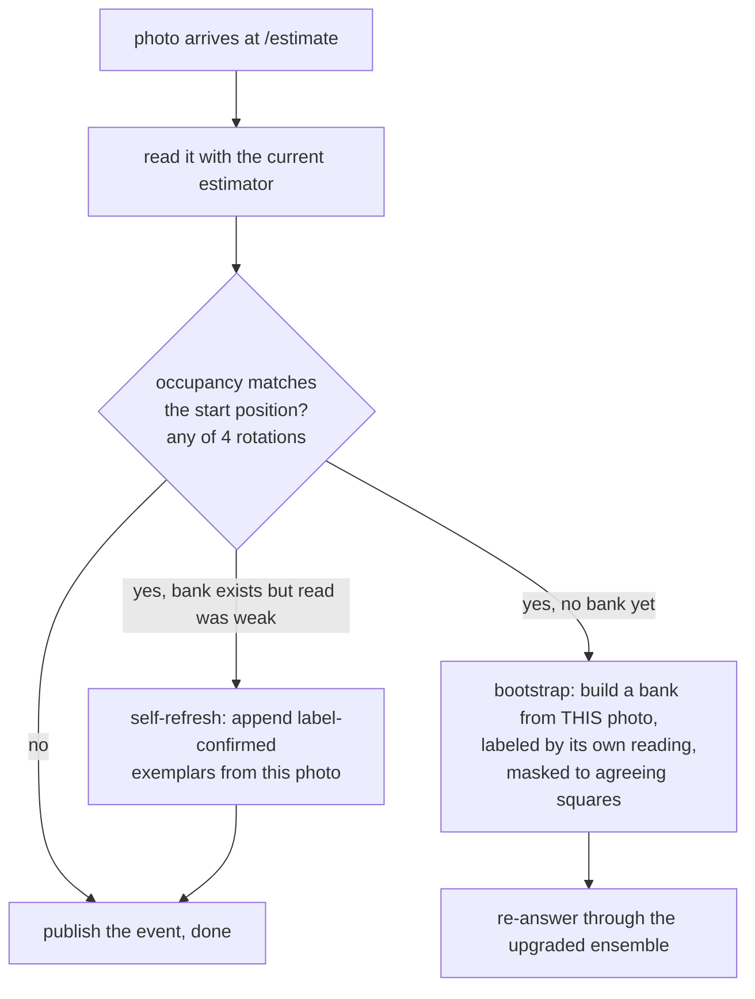

# Calibration and the exemplar bank

Calibration is how the reader adapts to *your* chess set in *your* lighting. It is
**optional, position-agnostic, and a booster** — it improves a working zero-shot
recognizer, it never replaces it.

Optional and position-agnostic are DESIGN decision #3: the system must work when dropped
into an arbitrary mid-game position, and a calibration round may use *any* known labeled
position, not specifically the start.

## What the bank is

A **kNN exemplar bank**, not per-class means. Every calibration crop is kept as its own
exemplar; a query square is scored by its **nearest exemplar per class** (per-class MAX
cosine). Two details do most of the work:

- **Per-board transductive centering** — the bank and the query batch are each re-centered
  on their own mean before the cosine step, which absorbs per-photo lighting and backbone
  shift.
- **Photometric variants** — each calibration crop is banked in several exposures.

Measured against class centroids, leave-one-photo-out on labeled real photos:

| Classifier | Score | Empty→piece hallucinations |
|---|---|---|
| class centroids | 261 / 320 | 28 |
| **kNN exemplar bank** | **294 / 320** | **6** |

Centroid files remain loadable — the classifier kind is picked from the file, not from a
flag. Calibrating from a new photo **adds** its exemplars to the running bank rather than
replacing it, so the bank only grows.

> [!tip] Calibrate in the light you will play in
> Single-frame calibration transfers poorly across lighting: ~70–75% of 64 squares between
> warm-lamp and daylight photos of the *same* set. Calibrating from both lightings recovers
> ~90–95%. Gray-world white balance does not help — tested.

## Zero-interaction calibration

The operator never has to press anything. This is engineered out of the occupancy/type split
in [[recognition-pipeline#Why piece type is the hard part]]: occupancy is style-robust, so
the *occupancy pattern* of the chess starting position is unmistakable even on a set the
system has never seen.

Three properties keep this honest:

- **Any of the four rotations** counts as a match, which also self-corrects a rotated corner
  detection. White's side is resolved by piece brightness.
- Only squares whose occupancy **agrees** with the start pattern contribute labels, so a
  photo taken a move or two into the game never banks a wrong label.
- The self-refresh path fires on *low-confidence* start sightings, so photographing the board
  before each game keeps adapting the bank to that evening's lighting with zero interaction.
  Validated: dim-room accuracy went from ~50% to 98.8% purely from same-conditions appends.

**The whole UX is: photograph the board before the game starts.** No buttons, no labeling.

## The four ways this got poisoned

The bank is persisted state in an otherwise stateless system, which makes it the one thing
that can be silently corrupted and then serve confident garbage. It happened four times.
Each fix is now a guardrail in the code.

> [!bug]- Incidents 1 & 2 — the bank clobbered by the test suite
> Persistence used a **cwd-relative default path**, so an ordinary `pytest` run overwrote the
> real calibration bank. The second time, a restart loaded the clobbered file and served
> garbage.
>
> **Fix:** persistence is opt-in. The bank is written only when `BR_SESSION_BANK` names a
> path; unset means calibration lives in memory and *nothing* is ever written. Guarded by a
> no-write test.
>
> **Ops rule this produced:** verify a restart with a known-photo read, not with `healthz`.

> [!bug]- Incident 3 — the fix that hid the bug
> With `autorotate` live, auto-detected corners that were 180° off produced *correct-looking
> reads* — the server silently rotated them. But **`/calibrate` still trusted the corner
> orientation**, so an operator's calibrate tap pushed colour-swapped exemplars into the
> persisted bank. Reads degraded to ~58/64 with White/Black flips on the back ranks.
>
> **Fix:** `/calibrate` probes the photo with the stateless trained member — which cannot
> have been poisoned — and rotates the claimed labels into agreement, accepting a rotation
> only when it beats the as-given labels by ≥8 squares. The chosen rotation comes back as
> `label_rotation`.
>
> **The general lesson:** any affordance that silently corrects a user-visible error masks
> that same error from every flow that still trusts it. When you add an auto-correction,
> audit every path that consumes the uncorrected value.

> [!bug]- Incident 4 — calibrating a mid-game board as "start"
> Operators tap Calibrate on whatever is on the board. A mid-game position got calibrated as
> the start position.
>
> **Fix:** `/calibrate` rejects with **HTTP 422** when fewer than 60% of the *claimed piece
> squares* agree with a stateless probe of the photo, at the best rotation. The reason is
> shown in the UI.
>
> **Why piece squares and not all squares:** a mid-game board and the start position share a
> mostly-empty middle, which inflates whole-board agreement to ~40/64 and hides the mismatch
> completely. Whole-board agreement is the wrong metric for verifying a claimed placement;
> piece-square agreement is the right one. This is exactly how the poisoning slipped past
> intuition.

Recovery from any of these is `tools/rebuild_session_bank.py` — see
[[runbook#Recovering a poisoned bank]].

## The second adaptation mechanism: the calibration fine-tune

The bank is not the only thing a calibrate photo can buy. Since 2026-08-11 the *same stored
frames* can also fine-tune the deployed classifier itself — LP-FT (linear probe, then
full fine-tune) on that one board — producing a per-board `tuned.onnx` that is served as a
**50/50 average with the base model**, not as a replacement (`BR_MODEL_TUNED`; see
[[runbook]]). The bank adapts the *comparison*; this adapts the *model*. They stack.

Measured on the user's own board: per-square 0.938 → **0.969** [0.966–0.972, 3 seeds],
wrong-type errors 19 → 9, hallucinations 1, occupancy held — and **no catastrophic
forgetting**: `chesscog_transfer`, an unseen physical set, *gains* (0.819 → 0.856). Live
`/estimate` reads 63/64 against the base model's 58/64, from a 56-second fine-tune.

> [!important] Session diversity is the lever — frame count is not
> Three frames from **three different lighting sessions** produce the result above. Frames
> from a single sitting are worthless for tuning **no matter how many you take** (2 frames /
> 1 session was the original pre-registration, and it did not validate: 0.935 vs 0.938).
> This is the same finding as the calibrate-in-your-playing-light tip above, sharpened: what
> the model needs is *variation*, and one sitting contains none.
>
> `calibrate_finetune.py` enforces this — it **refuses** input that does not span ≥3 sessions
> and quotes the measurement when it does; `--force` overrides loudly.

Two limits on record. Generalization was only ever measured on the same five `user_photos`,
so this is a per-board win, not a proven general one. And a tuned model **cannot be combined
with the two-model cascade** — that stack has never been measured, so requesting both is a
hard startup error rather than a silent guess.

## The fifth way it went wrong: it ate the eval set

Not a corruption — a measurement failure. `tools/build_exemplar_bank.py` builds the
bank's base *from `data/eval/ground_truth.json`*, so the bank has seen nine of the ten
boards it is scored on. It returns 64/64 on exactly those nine and **43/64** on the one
it never saw, and that inflated an ensemble headline for months.

The bank being near-perfect on conditions it has seen is the feature, not the bug — it
is why the ensemble works at all. The bug is scoring it there. See
[[measuring-accuracy#Contamination]].

## Related

- [[measuring-accuracy]] — why a bank-backed number is an upper bound, and what to do instead
- [[recognition-pipeline]] — the bank is one member of the deployed ensemble
- [[runbook]] — env vars, verification, recovery
- [[operating-envelope]] — the conditions under which a calibrate is worth doing at all
