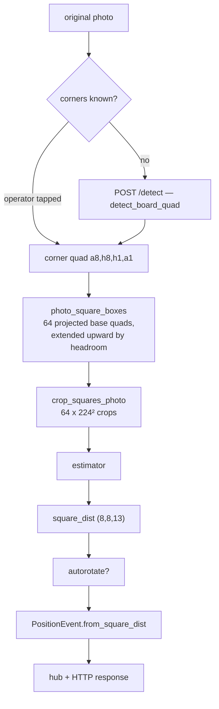

# Recognition pipeline

How a photo becomes an 8×8 grid of 13-class distributions. This note describes the
**snapshot path** (`POST /estimate`), which is the interesting one; the streaming path is
the same estimator fed a rectified crop instead of an original photo.

## The path

## Cropping is where the accuracy is

Each square's crop is **not** a tile of a rectified board. It is the square's projected base
quad in the *original photo*, extended upward by `headroom` square-widths and outward by
`side_pad`, then clipped, padded and resized to 224². `photo_square_boxes` returns those
boxes standalone; `crop_squares_photo` is the clip-pad-resize on top of them.

> [!danger] Headroom is load-bearing, and it once silently broke everything
> The geometry drifted to `headroom=0.15` — near-base-only crops. At a steep camera
> elevation (~25–45°) a tall piece's head sits a full square *above* its base, so the
> classifier only ever saw lower bodies. Measured consequence on one steep dim board:
> **57/64, with every major piece wrong** — q→b, K→Q, R→P, B→P — plus phantom pawns
> hallucinated from a cut-off head one square up.
>
> Deployed geometry is **`headroom=1.6, side_pad=0.15, size=224`**: a whole standing piece.
> Retraining with tall crops moved the unseen-style holdout from 0.665 to 0.835 and real
> photos from 415 to 430 of 448. More is not better — `headroom=1.8, side_pad=0.25` ties on
> the holdout and *loses* on real photos (409).

Because a mismatch between training crops and serving crops is invisible until accuracy
quietly collapses, **the geometry travels with the model** in a `<model>.onnx.meta.json`
sidecar that `TrainedEstimator` reads. Never hard-code it on either side.

The `?debug=1` overlay draws from `photo_square_boxes` — the same function recognition
crops with — so the visualization cannot drift into showing a re-derivation of the geometry.

## The estimators

All of them satisfy the same `Estimator` protocol (`estimate(frame) -> PositionEvent`),
plus `estimate_photo(frame, corners)` for the photo-box path.

| Estimator | What it is | Where it shines |
|---|---|---|
| `StubEstimator` | reports a fixed placement, ignores pixels | M0 walking skeleton; fresh clone with no `models/` |
| `CentroidEstimator` | an `Embedder` (DINOv2-S ONNX) + a classifier — either class centroids or a kNN exemplar bank | conditions it has been calibrated on |
| `TrainedEstimator` | multi-style supervised ResNet18, ONNX, crop → 13 logits | chess sets it has never seen |
| `EnsembleEstimator` | distribution-level blend of a trained member and a bank member | everywhere — it tracks the better member square by square |

### Selection at startup

Resolved from the environment at import time, in this order:

1. `BR_CENTROIDS` — an explicit curated calibration file wins outright.
2. `BR_MODEL` — the trained classifier. If `BR_SESSION_BANK` also names an existing bank,
   the two are wrapped in an `EnsembleEstimator` rather than one replacing the other.
3. A persisted session bank alone, when auto-calibration is enabled.
4. `StubEstimator`.

A `BR_MODEL` that fails to load (missing file, ONNX Runtime mismatch, truncated download)
prints a warning and falls through to the next tier — a fresh clone with no `models/`
directory still runs `docker compose up` successfully.

### Why blending beats either member

The bank is near-perfect under conditions it has seen and brittle outside them; the trained
model is the reverse. On the labeled eval:

| Configuration | Score |
|---|---|
| previous model alone (`v1`, short crops) | 579 / 640 |
| deployed model alone (`d16`, tall crops) | 605 / 640 |
| trained ⊕ bank, maturity-weighted **(deployed)** | **633 / 640** |

The blend weight follows bank maturity: **≥1024 exemplars → 30/70 trained/bank**, otherwise
50/50. A mature bank has earned the extra trust; a one-photo bootstrap has not. (At a flat
50/50 a mature bank's correct read on backlit pawns was occasionally outvoted by the tall-crop
model's colour flip.)

## Why piece type is the hard part

> [!warning] The single most important measured fact in this project
> **Occupancy transfers across chess sets; piece type does not.** Cross-style occupancy runs
> 94–99% for free. Cross-style piece type collapses — rooks, knights, bishops, queens and
> kings fall to 0–40% recall while empties and pawns survive.

Seven training-free routes were measured against this and all failed at roughly the same
~80% ceiling: kNN transfer from a public dataset, a linear probe on the same embeddings,
SAM2-segmented crops, ~50 classical embedding-alignment configs, published pretrained
models, bigger and different frozen backbones, and a shape-biased Stylized-ImageNet ResNet.

The diagnostic that settles it: a linear probe trained on ChessReD embeddings reaches 90.7%
*within* ChessReD but only 254/320 across the style gap — tying plain kNN. The gap is in the
**features**, not the classifier. No frozen backbone fixes it; scale does not help
(DINOv2 S→B is flat), and shape bias actively over-specializes (best same-style at 296/320,
worst cross-style at 219).

What did work was learning style-invariance from **many** piece styles at once — see
[[training-and-data]]. Evidence and full numbers: [[2026-07-18-zero-shot-campaign]].

One unexploited win from that sweep: DINOv2-S **central-column patch pooling** (mean of the
middle 8 of 16 token columns instead of CLS) beats CLS by +9 squares with near-perfect
occupancy. Cheap, measured, never shipped.

## Orientation

Corner geometry cannot say which corner is `a8`, and the CV layer may not infer orientation
from the pieces as a *stateful* fact (DESIGN decision #15). What it may do is resolve the
grid rotation of a single frame by chess plausibility, which is a per-frame property:

- fewest pawns on ranks 1 and 8, tie-broken by
- White's piece mass nearer rank 1.

This is `autocalib.resolve_rotation`, applied when the request carries `autorotate=1`. The
snapshot page sends that flag **only while the operator has not hand-placed or relabelled
the corners** — an operator's labelling is authoritative and is never silently overridden.

> [!failure] Two cues that look obvious and are wrong
> **Square-colour parity** and **printed border coordinates** are deliberately not used.
> Players set boards up ignoring the printed coordinates, and boards without FIDE-standard
> printing exist. Both were observed in a single field session: a position played 90° to the
> printed grid, and a shot where parity would have "corrected" an already-correct
> orientation.

Auto-correction has a sting in the tail: it hid a corner-orientation error from `/calibrate`,
which still trusted it. See [[calibration-and-the-bank#The four ways this got poisoned]].

## Advisory warnings

`/estimate` attaches `warnings` without ever refusing to answer, in keeping with "stream
what you see, flag what you doubt":

- `low_light` — mean pixel value below 55 (evening-room shots measure ~37).
- `very_low_angle` — projected board aspect below 0.62.

Both are explained in [[operating-envelope]].

## Related

- [[architecture]] — where this sits
- [[calibration-and-the-bank]] — the per-set half of the ensemble
- [[operating-envelope]] — when to distrust the output
- [[training-and-data]] — where the trained half comes from
