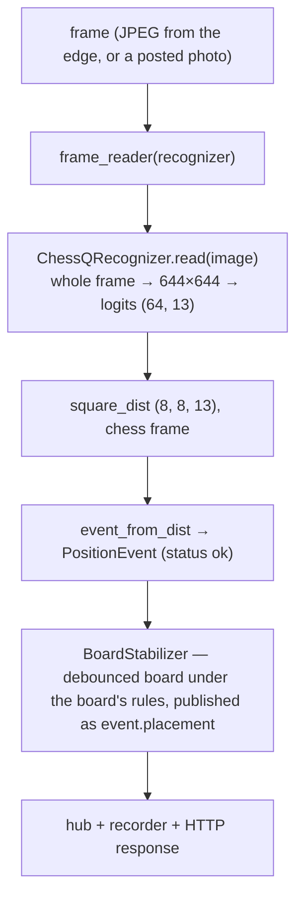

# Recognition pipeline

How a frame becomes an 8×8 grid of 13-class distributions. Since 2026-11-24 (DESIGN
D10) the answer is one model call: **ChessQ Lite V6** reads the whole frame and returns
the board in the chess frame. There is no cropping, no corner geometry, no exemplar bank
and no calibration on this path. The streaming path (`WS /ingest`) and the snapshot path
(`POST /estimate`) run the same read.

## The path



The code, in order:

| Step | Where | What it does |
|---|---|---|
| Read | `recognizer.frame_reader` | Hands the frame's whole image to the recognizer. Any `corners` an older edge or recording still sends are ignored. |
| Model | `chessq.ChessQRecognizer` | Resizes the BGR frame to 644×644 (aspect ignored, `INTER_AREA`), RGB, ImageNet-normalised; runs the ONNX model; softmaxes the `logits` output into protocol class order. The second output, `direction`, is not used. |
| Event | `recognizer.event_from_dist` | Builds the position event (`PositionEvent`) from the distribution, uncalibrated, always `status: ok` (DESIGN D1). |
| Settle | `stabilize.BoardStabilizer` | Holds a board until it has read the same for the settle window; a streamed event publishes it as `placement` (`with_placement`), with `pending` where the read disagrees. Under the board's `rules: standard` it never commits a board more impossible than the one it holds (`rules.py`: at most one king per colour, piece-count and promotion budgets, DESIGN D14); `square_dist` stays the model's own. |

## The recognizer seam

`recognizer.py` holds the one interface a model implements:

```python
class Recognizer(Protocol):
    name: str
    frame: Literal["chess"]
    model_path: str | None
    def read(self, image: np.ndarray) -> np.ndarray: ...  # (8, 8, 13), chess frame
```

Three implementations exist:

- **`ChessQRecognizer`** (`chessq.py`) — the served model. `BR_CHESSQ` names the ONNX
  file, and the session takes CUDA when onnxruntime can use it (`onnxrt.cuda_providers`),
  the CPU otherwise. One release ships as two files, chosen by hardware: the **fp32
  export** on a GPU (`make dev`, `make gate`) and the author's **int8** on a CPU
  (`make dev-cpu`, `compose.yaml`). `make models` downloads the int8 file and the FP16
  safetensors at a pinned Hugging Face revision, checks their SHA-256 against
  `models/chessq/*.json`, and exports the fp32 file with the official package
  (`tools/chessq_export`, checked square by square against the package's own
  prediction). The weights are PolyForm Noncommercial — see `THIRD-PARTY.md`.
- **`StubRecognizer`** — the walking skeleton: a fixed placement, whatever the pixels. It
  serves when `BR_CHESSQ` is unset or names no file, and it says so (a stderr banner at
  startup, and `recognizer.fallback` on `/healthz`). A fresh clone without `make models`
  therefore still runs end to end, on a board nobody should mistake for a read.
- **`SimRecognizer`** (`tests/_sim_recognizer.py`, test-only) — a template match that reads
  `core.sim.render_board` renders exactly, so the end-to-end stream test checks real pixels
  travelling through the pipe. ChessQ cannot stand in: it reads 0 of 14 sim renders
  perfectly.

Another model (ChessCam v2 is the candidate) is one more file implementing the protocol,
plus a branch in `build_from_env`.

## The chess frame

The recognizer finds the board **and its orientation** in the frame, so every placement it
returns is already in the chess frame: rank 8 first, file a first, as FEN writes it. This
reverses the old locked decision #15 (the crop stack read in the frame its corners defined
and guessed the rotation separately; see DESIGN, "Superseded decisions"). Events, labels, ground truth, eval and replay all use the
chess frame; the protocol's `orientation` field is now always `a1_bottom_left`.

Because the model infers orientation, the measuring tools check it:

- `eval` records, for every labeled still, the quarter-turn under which the read agrees best
  with its truth, and lists the boards where that is not 0° (`TURNED:` in the report).
- `eval-session` does the same over a recorded take's reads and warns when the majority is
  not 0° — a truth file in the wrong frame, or a misread orientation.

The cold probe found no rotated read on any of the 467 images it scored
([[2026-11-24-chessq-framing]]).

## Framing: the board must fill the frame

ChessQ squashes the whole frame to 644×644, so the board's share of the frame decides how
many pixels each square gets. Measured on 467 images by padding them to wider framings
([[2026-11-24-chessq-framing]]):

| Board width / frame width | Effect |
|---|---|
| ~83 % (the /camera crop every gate take used) | baseline |
| 50 % | ≤ 0.1 point per square lost |
| 35 % | perfect boards fall from 82 % to 5 % (reflect pad) or 69 % (gray pad) |
| portrait 9:16 | perfect boards fall to 57 % |

So the edge sends a crop in which the board fills at least half of the width (plan
decision D1): a plain rectangle the operator draws on `/control` over the phone's
full-frame preview, which the phone then applies (DESIGN D11). `/control` warns when the
whole frame is sent, when the rectangle is taller than wide or more than twice as wide as
tall, and when the phone is upright.

## Measured

- **Replay gate** — the seven gate takes replayed through the shipped stack (base
  `guard-only`): **341/361 raw, 314/361 settled** perfect boards. On the original
  four takes ChessQ first read 92/101 raw and 84/101 settled, against the old crop stack's
  5 and 35 ([[2026-11-24-chessq-v6-replay-gate]]). `make gate` reruns it; every deletion step of the
  simplification was held to identical placements, prior and settled boards (the prior
  decoder is gone since, DESIGN D14).
- **Stills** — `eval data/eval`: 20/21 perfect boards; with the upload labels, 41/47
  ([[measuring-accuracy]]).
- **Latency** — on the GTX 1650 the fp32 export runs at ~205 ms per read; the int8 file
  runs at ~0.4–0.7 s there (its quantized matmuls have no CUDA kernels) but is the faster
  file on a CPU (~660 vs ~990 ms). The fp32 and int8 files read all 133 gate reads
  identically, and the four gate replays take 31 s instead of 65 s
  ([[2026-11-24-chessq-gpu-formats]]).

## Known weaknesses

- **Hands read as confident empties** (p ≥ 0.96). Confidence cannot flag a hand, so hands
  are kept out by read scheduling (burst-end reads, `stream/schedule/`) and the settle debounce,
  not by thresholds. A shorter settle window lets more hand frames through; the 08-13 take
  must settle every scored read. The settle window must stay strictly between the burst-end
  spacing and the run's span (shipped: 0.3 s spacing < 0.5 s window ≤ 0.6 s span): a window two
  reads can span let a hand settle in 19 of 30 swept configs ([[2026-11-24-latency-round2]]).
- **A hand that rests still** on the board reads as rest to the motion meter, so no burst
  protects it: on live take 2 a hand held over f6 for ~2.5 s settled (every config did so). This is
  a meter limit; only a direct hand signal would fix it.
- **Small boards in a wide frame** fail (table above).
- **One third-party, noncommercial model.** The revision is pinned and the SHA-256 checked;
  ChessCam v2 is the hedge.

## Advisory warnings

`/estimate` attaches `warnings` without ever refusing to answer:

- `low_light` — mean pixel value below 55 (evening-room shots measure ~37).

See [[operating-envelope]].

## Before ChessQ

Until 2026-11-24 recognition cut 64 per-square crops from the photo along the board's
corners, classified them with an in-house crop classifier (a two-model cascade) boosted by
a per-set exemplar bank, and demoted narrow black-bishop wins. That stack, its calibration
round and its training harness are deleted; the last commit that has all of it is
`457cf96`. What it taught is in [[calibration-and-the-bank]], [[training-and-data]] and
`docs/reports/`.

## Related

- [[architecture]] — where this sits
- [[operating-envelope]] — when to distrust the output
- [[measuring-accuracy]] — replay, eval and eval-session
